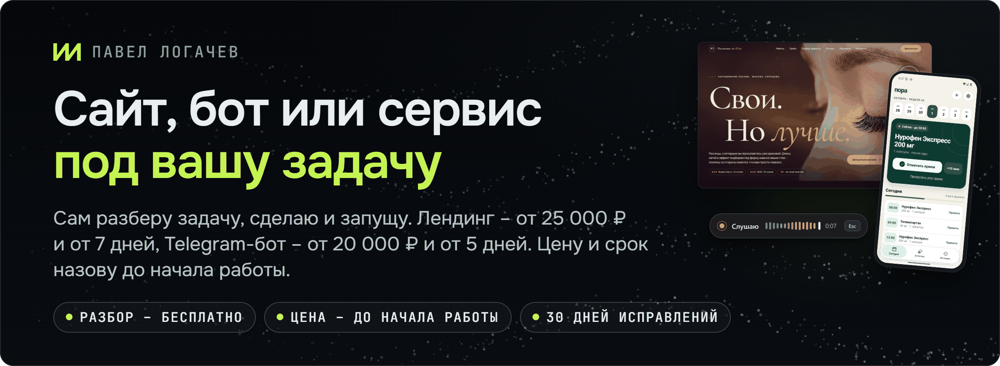
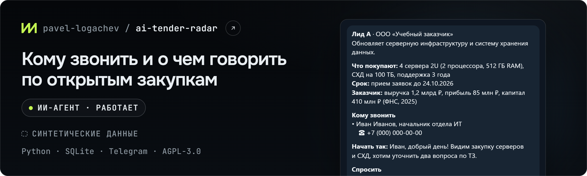
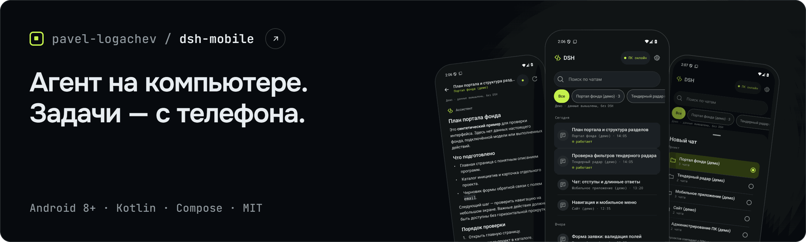
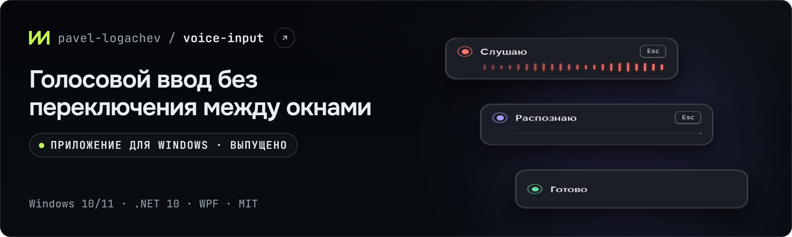

<a href="https://logachev.net/"><picture><source media="(max-width: 767px)" srcset="assets/profile-banner-mobile.png"></picture></a>

[Сайт](https://logachev.net/) · [Все проекты](https://logachev.net/projects/) · [Написать в Telegram](https://t.me/pavel_logachev)

Внедряю ИИ-агентов в продажи и закупки. В ИТ 20 лет: десять лет был инженером, последние десять и сейчас веду проекты системной интеграции для госсектора и крупных компаний до 250 млн ₽.

Свои ИИ-проекты делаю с командой ИИ-агентов. Код пишут агенты, я проектирую, проверяю и запускаю. Здесь их открытый код, релизы и ограничения.

## Главные проекты

<a href="https://github.com/pavel-logachev/ai-tender-radar"><picture><source media="(max-width: 767px)" srcset="assets/card-ai-tender-radar-mobile.png"></picture></a>

**[AI Tender Radar](https://github.com/pavel-logachev/ai-tender-radar) – кому звонить, из открытых закупок.** Агент читает закупки серверов и СХД на Bidzaar, документы и отчетность ФНС, находит человека с телефоном и присылает менеджеру в Telegram карточку для звонка. Цифры телефона код сверяет с прочитанным источником. Работает в боевом режиме, разобрал закупки сотен компаний. 726 тестов.

 

**Что посмотреть:** [сверка контактов с источником](https://github.com/pavel-logachev/ai-tender-radar/blob/main/agent_radar/lead_agent/grounding.py) · [архитектура](https://github.com/pavel-logachev/ai-tender-radar/blob/main/docs/ARCHITECTURE.md) · [протокол проверки](https://github.com/pavel-logachev/ai-tender-radar/blob/main/docs/VERIFICATION.md) · [что опубликовано](https://github.com/pavel-logachev/ai-tender-radar/blob/main/docs/PUBLICATION_BOUNDARY.md) · [разбор в журнале](https://logachev.net/journal/ii-agent-dlya-generacii-lidov-zakupki/) · [демо на 1 минуту](https://logachev.net/ai/tendery/#demo)

<a href="https://github.com/pavel-logachev/dsh-mobile"><picture><source media="(max-width: 767px)" srcset="assets/card-dsh-mobile-mobile.png"></picture></a>

**[DSH Mobile](https://github.com/pavel-logachev/dsh-mobile) – управление ИИ-агентами с телефона.** Неофициальный Android-клиент для DeepSeek Harness: чат проекта, задача агенту, ответ в реальном времени и уведомление, когда агент закончил. Приложение, плагин для компьютера и защищенное соединение по Wi-Fi или через Tailscale, без облака. 551 модульный тест у приложения, 389 у плагина.

  

**Что посмотреть:** [архитектура](https://github.com/pavel-logachev/dsh-mobile/blob/main/docs/ARCHITECTURE.md) · [протокол](https://github.com/pavel-logachev/dsh-mobile/blob/main/docs/PROTOCOL.md) · [безопасность](https://github.com/pavel-logachev/dsh-mobile/blob/main/docs/SECURITY.md) · [технический разбор на Хабре](https://habr.com/ru/articles/1099110/) · [уведомления без пушей Google](https://habr.com/ru/articles/1103324/) · [скачать APK](https://github.com/pavel-logachev/dsh-mobile/releases/latest)

<a href="https://github.com/pavel-logachev/voice-input"><picture><source media="(max-width: 767px)" srcset="assets/card-voice-input-mobile.png"></picture></a>

**[Voice Input](https://github.com/pavel-logachev/voice-input) – голосовой ввод в любое поле Windows.** Зажали клавишу, сказали фразу, отпустили, и текст появился у курсора. Распознавание через OpenAI по ключу пользователя, моделью GigaAM на компьютере без интернета или на своем сервере. 251 автотест. GigaAM понимает только русскую речь.

  

**Что посмотреть:** [архитектура](https://github.com/pavel-logachev/voice-input/blob/main/docs/ARCHITECTURE.md) · [тесты](https://github.com/pavel-logachev/voice-input/tree/main/tests) · [исследование локальных моделей](https://github.com/pavel-logachev/voice-input/blob/main/docs/MODEL_RESEARCH.md) · [скачать установщик](https://github.com/pavel-logachev/voice-input/releases/latest)

## Как я проверяю код, который пишут агенты

- У каждого проекта автотесты и CI. 726 тестов в Tender Radar, 551 в DSH Mobile, 251 в Voice Input.
- Факты, цифры и деньги проверяет код, а не модель. Телефон в карточке Tender Radar сверяется с источником, цены и остатки в Stock Configurator подставляет код.
- Решения с последствиями принимает человек: звонок, отправку КП, состав спецификации.
- Ограничения и то, что не опубликовано, описаны в README каждого проекта.

## Другие проекты

- **[Stock Configurator](https://github.com/pavel-logachev/stock-configurator)** – черновик серверной спецификации в Excel из наличия на складе дистрибьютора. Цены и остатки подставляет код, состав подтверждает инженер. Первая рабочая версия.
- **[«Пора»](https://github.com/pavel-logachev/pora)** – напоминания о лекарствах на Android без аккаунта и интернета, справочник ЕСКЛП на 23 001 препарат. 78 автотестов.
- **[AI Proposal Builder](https://logachev.net/journal/kommercheskoe-predlozhenie-ii/)** – КП по шаблону компании в DOCX и PDF, суммы и НДС считает программа. Первая рабочая версия.
- **[Портал заявок на поддержку предприятий](https://logachev.net/projects/#case-fund-portal)** – реестр заявок, этапы, роли и генерация документов. Пилот и прототип, код закрыт.
- **[«Реснички от Юли»](https://resnichki.moscow/)** – сайт студии и реклама, заявки сразу в Telegram. Клиентский проект, код закрыт.

## Работа со мной

Делаю ИИ-агентов и автоматизацию (пилот одного процесса от 50 000 ₽, 2–4 недели), а также сайты, Telegram-ботов, веб-сервисы и приложения. Цены и сроки на [logachev.net](https://logachev.net/). Разбор задачи на 20–30 минут бесплатный, цену называю до начала работы, 30 дней исправлений после запуска.

Написать: [Telegram](https://t.me/pavel_logachev) · [pavel@logachev.net](mailto:pavel@logachev.net). Работаю из Москвы, удаленно по России и СНГ.

В ноябре 2026 года прошел онлайн-курсы Хельсинкского университета «Elements of AI» ([сертификат](https://certificates.mooc.fi/validate/5bdkbulf8vh)) и Гарвардского университета CS50P ([сертификат](https://cs50.harvard.edu/certificates/0d190f08-a16f-459b-a193-17d1925ad103)).
