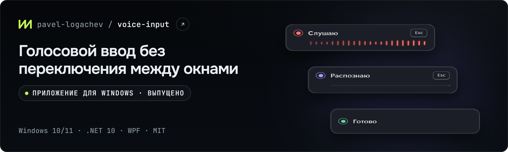
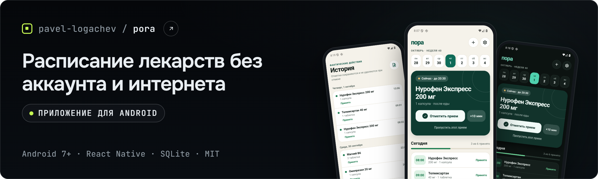
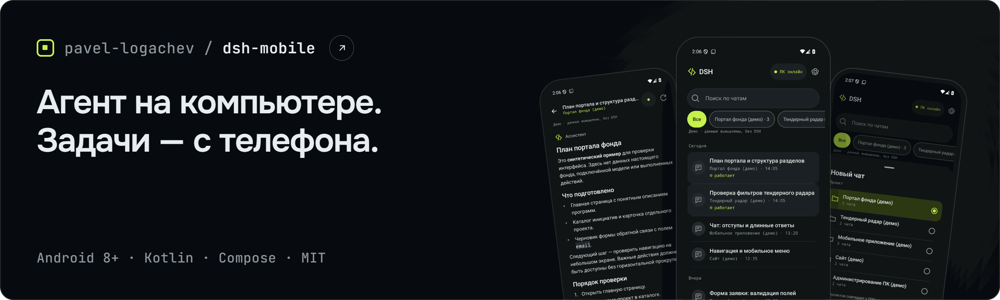
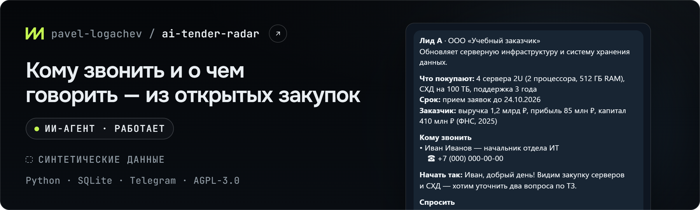
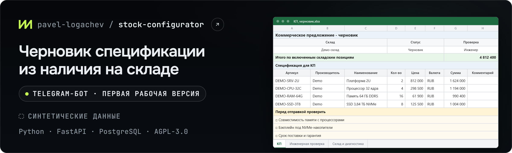
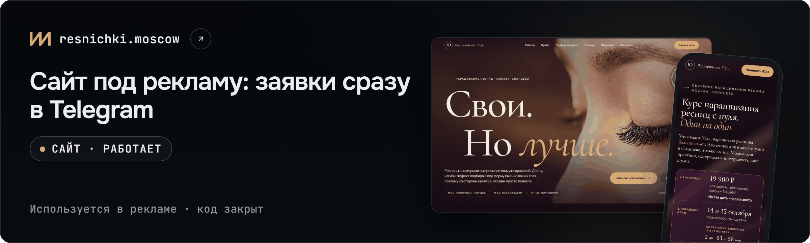
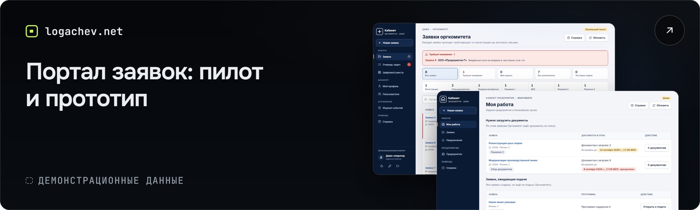

<a href="https://logachev.net/"><picture><source media="(max-width: 767px)" srcset="assets/profile-banner-mobile.png"></picture></a>

[Сайт](https://logachev.net/) · [Журнал](https://logachev.net/journal/) · [Telegram-канал](https://t.me/neirogazeta) · [Обсудить задачу](mailto:pavel@logachev.net)

20 лет в ИТ: инженер, затем руководитель проектов. Отвечаю и работаю лично.

**Разбор 20–30 минут — бесплатно · Цена не меняется без изменения объема · 30 дней исправлений после запуска**

Здесь — то, что можно проверить: открытый код, релизы и ограничения моих проектов.

## Что сделаю и сколько это стоит

- **[Сайты, лендинги и запуск рекламы](https://logachev.net/sites/) — от 25 000 ₽.** Чтобы о вас узнавали и оставляли заявки. Если нужно, сам запущу рекламу: Яндекс Директ, Яндекс Бизнес, VK Реклама, Авито. Лендинг с запуском рекламы — от 40 000 ₽.
- **[Веб-сервисы: порталы, личные кабинеты, CRM, внутренние системы](https://logachev.net/services/) — от 60 000 ₽.** Заявки, документы и этапы в одном месте, у каждого свой доступ.
- **[Telegram-боты](https://logachev.net/bots/) — от 20 000 ₽.** Бот принимает заявки и запись, отвечает на частые вопросы, связывается с CRM, оплатой или ИИ.
- **[Приложения для Windows и Android](https://logachev.net/apps/) — от 100 000 ₽.** Отдельный инструмент под вашу задачу — на компьютере или телефоне.
- **[Автоматизация и ИИ-агенты](https://logachev.net/ai/) — от 50 000 ₽.** Рутину с данными и документами берет программа, решения остаются за человеком.
- **[Нестандартные задачи](https://logachev.net/#unusual).** Инструменты для исследований, работы и личных задач. Не знаете, какой инструмент нужен, — расскажите, что хотите получить.

## Проекты, которые можно проверить

Выпущенные приложения, рабочие системы, клиентский сайт и прототипы. Статус указан у каждого, у пяти открыт код.

### Приложения

<a href="https://github.com/pavel-logachev/voice-input"><picture><source media="(max-width: 767px)" srcset="assets/card-voice-input-mobile.png"></picture></a>

**[Voice Input](https://github.com/pavel-logachev/voice-input) — голосовой ввод без переключения между окнами.** Зажали горячую клавишу, сказали фразу, отпустили — текст появился у курсора в любом поле ввода Windows. Сделал интерфейс и настройки, запись звука, распознавание через OpenAI, вставку текста и установщик. Автотесты проверяют диктовку, отмену, хранение ключа и вставку. Для распознавания нужны интернет и API-ключ OpenAI.

  

**Что посмотреть:** [архитектура](https://github.com/pavel-logachev/voice-input/blob/main/docs/ARCHITECTURE.md) · [тесты](https://github.com/pavel-logachev/voice-input/tree/main/tests) · [исследование локальных моделей](https://github.com/pavel-logachev/voice-input/blob/main/docs/MODEL_RESEARCH.md) · [скачать установщик](https://github.com/pavel-logachev/voice-input/releases/latest)

<a href="https://github.com/pavel-logachev/pora"><picture><source media="(max-width: 767px)" srcset="assets/card-pora-mobile.png"></picture></a>

**[Пора](https://github.com/pavel-logachev/pora) — расписание лекарств всегда под рукой.** Напоминания, отметка приема прямо из уведомления, история и встроенный справочник ЕСКЛП на 23 001 препарат; основные функции работают без аккаунта и интернета. Спроектировал и сделал приложение, хранение данных на телефоне, необязательную синхронизацию и сервер для нее; выпустил подписанный APK. 78 автотестов. Приложение не назначает лечение и не проверяет совместимость лекарств.

  

**Что посмотреть:** [архитектура и модель доверия](https://github.com/pavel-logachev/pora/blob/main/docs/ARCHITECTURE.md) · [уведомления](https://github.com/pavel-logachev/pora/tree/main/src/notifications) · [синхронизация](https://github.com/pavel-logachev/pora/tree/main/src/sync) · [скачать APK](https://github.com/pavel-logachev/pora/releases/latest)

<a href="https://github.com/pavel-logachev/dsh-mobile"><picture><source media="(max-width: 767px)" srcset="assets/card-dsh-mobile-mobile.png"></picture></a>

**[DSH Mobile](https://github.com/pavel-logachev/dsh-mobile) — управление ИИ-агентами с телефона.** Неофициальный Android-клиент для DeepSeek Harness: открыть чат проекта, поставить задачу, следить за ответом в реальном времени и получить уведомление, когда агент закончил. Сделал приложение, плагин для компьютера и защищенное соединение между ними по Wi-Fi или через Tailscale. 221 JVM-тест и 9 тестов на эмуляторе у приложения, 162 теста плагина. Компьютер должен быть включен, облачного сервера нет.

  

**Что посмотреть:** [архитектура](https://github.com/pavel-logachev/dsh-mobile/blob/main/docs/ARCHITECTURE.md) · [протокол](https://github.com/pavel-logachev/dsh-mobile/blob/main/docs/PROTOCOL.md) · [безопасность](https://github.com/pavel-logachev/dsh-mobile/blob/main/docs/SECURITY.md) · [скачать APK](https://github.com/pavel-logachev/dsh-mobile/releases/latest)

### Боты, автоматизация и ИИ-агенты

<a href="https://github.com/pavel-logachev/ai-tender-radar"><picture><source media="(max-width: 767px)" srcset="assets/card-ai-tender-radar-mobile.png"></picture></a>

**[AI Tender Radar](https://github.com/pavel-logachev/ai-tender-radar) — кому звонить и о чем говорить, из открытых закупок.** Агент сам читает закупки серверов и СХД на Bidzaar, документы и отчетность ФНС, находит человека с телефоном и присылает менеджеру в Telegram готовую карточку для звонка. Цифры телефона код механически сверяет с прочитанным источником. На 16 закупках агент нашел человека с проверенным телефоном в 8–9 случаях, прежний код — в 3. Это один рабочий прогон, набор не опубликован. В репозитории 726 тестов.

 

**Что посмотреть:** [сверка контактов с источником](https://github.com/pavel-logachev/ai-tender-radar/blob/main/agent_radar/lead_agent/grounding.py) · [архитектура](https://github.com/pavel-logachev/ai-tender-radar/blob/main/docs/ARCHITECTURE.md) · [протокол проверки](https://github.com/pavel-logachev/ai-tender-radar/blob/main/docs/VERIFICATION.md) · [что опубликовано](https://github.com/pavel-logachev/ai-tender-radar/blob/main/docs/PUBLICATION_BOUNDARY.md) · [разбор в журнале](https://logachev.net/journal/ii-agent-dlya-generacii-lidov-zakupki/)

<a href="https://github.com/pavel-logachev/stock-configurator"><picture><source media="(max-width: 767px)" srcset="assets/card-stock-configurator-mobile.png"></picture></a>

**[Stock Configurator](https://github.com/pavel-logachev/stock-configurator) — черновик спецификации из наличия на складе.** Менеджер пишет запрос обычным текстом в Telegram и получает Excel с черновиком серверной спецификации — только из позиций, которые есть на складе дистрибьютора. Модель подбирает оборудование, артикулы, цены и остатки подставляет код, состав и совместимость подтверждает инженер. Сделал бота, API на FastAPI, коннекторы к складам и отчеты. Первая рабочая версия; экономия времени не измерялась.

 

**Что посмотреть:** [архитектура](https://github.com/pavel-logachev/stock-configurator/blob/main/docs/ARCHITECTURE.md) · [сверка со складом](https://github.com/pavel-logachev/stock-configurator/tree/main/app/matching) · [офлайн-оценка](https://github.com/pavel-logachev/stock-configurator/tree/main/app/evaluation) · [что опубликовано](https://github.com/pavel-logachev/stock-configurator/blob/main/docs/PUBLIC_RELEASE_BOUNDARY.md) · [разбор в журнале](https://logachev.net/journal/podbor-oborudovaniya-po-skladu-ii/)

### Сайты и веб-сервисы для клиентов

Код этих проектов закрыт, данные клиентов не публикую.

<a href="https://resnichki.moscow/"><picture><source media="(max-width: 767px)" srcset="assets/card-resnichki-mobile.png"></picture></a>

**[«Реснички от Юли»](https://resnichki.moscow/) — сайт и реклама: заявки сразу в Telegram.** Сайт студии наращивания ресниц и [страница курса](https://resnichki.moscow/kurs). Рекламу настраивал сам — Яндекс Директ, VK Реклама и Авито: в первые дни после запуска пошли записи в студию и первые продажи курса. Заявки сохраняются на сервере и сразу приходят в Telegram — мне и Юле.

<a href="https://logachev.net/#case-fund-portal"><picture><source media="(max-width: 767px)" srcset="assets/card-fund-portal-mobile.png"></picture></a>

**[Портал заявок на поддержку предприятий](https://logachev.net/#case-fund-portal) — портал, кабинет или CRM под ваш процесс.** Так собираю порталы, личные кабинеты, CRM и внутренние системы: заявки, документы, этапы, роли и отчеты — под то, как работаете вы. В этом проекте — реестр заявок, очередь задач, этапы рассмотрения, журнал действий и генерация документов; сервис читает PDF и DOCX и предлагает значения полей с указанием места в исходнике, а ключевые решения подтверждает человек. Часть портала — пилот на сервере, часть — прототип; на скриншотах демонстрационные данные.

**[AI Proposal Builder](https://logachev.net/journal/kommercheskoe-predlozhenie-ii/) — коммерческое предложение по шаблону компании.** Менеджер отправляет вводные одним сообщением — бот уточняет недостающее и собирает КП в DOCX и PDF. Суммы и НДС считает программа, отправку подтверждает менеджер. Первая рабочая версия.

## Как я работаю

1. **Бесплатный разбор: 20–30 минут.** Вы рассказываете, что нужно и как работаете сейчас, — готовое ТЗ не требуется. После разговора называю первый объем работ, цену и срок.
2. **Делаю и запускаю первую версию.** Проектирую, разрабатываю, настраиваю и запускаю сам: вы общаетесь с тем, кто делает. Начинаем с согласованного первого объема, чтобы вы получили работающий результат, а не долгий проект.
3. **Развиваю после запуска.** 30 дней бесплатно исправляю ошибки в сделанном. Дальше решаем, что добавить или изменить: развитие и сопровождение согласуем отдельно.

**Что я обещаю**

- **Отвечаю в течение рабочего дня** — сам, без менеджеров.
- **Цена не меняется без изменения объема.** Стоимость и срок называю после разбора, до начала работы.
- **Оплата двумя частями:** половина перед началом работы, половина после запуска согласованного объема.
- **30 дней исправлений бесплатно.** Если после запуска в сделанном найдется ошибка, исправлю ее за свой счет.
- **Код и доступы остаются у вас.** После оплаты передаю исходный код и все доступы: вы не привязаны ко мне.
- **Договор и закрывающие документы.** После сдачи работы вы получаете акт и документы об оплате.

## Обо мне

В ИТ 20 лет. Первые десять был инженером: сети, серверы, рабочие места, информационная безопасность. Следующие десять — менеджер по ключевым клиентам и руководитель проектов: продавал и вел сложные ИТ-проекты, оборудование и ПО, для международных компаний уровня Alibaba, Nokia, Walt Disney и Greif и федеральных госзаказчиков. Проекты до 250 млн ₽, команды из 5–10 человек, закупки по 44-ФЗ и 223-ФЗ. Поэтому я разбираюсь в технике, понимаю, как устроены продажи и закупки в крупных компаниях, и умею вести проект от задачи до сдачи.

С ИИ-агентами у меня больше 1000 часов практики: начинал с агентов для собственной работы в продажах ИТ-оборудования. В каждом проекте сам разбираю задачу, проектирую, проверяю результат, настраиваю и запускаю. ИИ использую там, где он полезен, и не навязываю там, где надежнее обычный код.

## Расскажите, что хотите сделать

Напишите в двух словах, что нужно сделать, — [на почту](mailto:pavel@logachev.net) или [в Telegram](https://t.me/pavel_logachev). Отвечу сам в течение рабочего дня, договоримся о бесплатном разборе на 20–30 минут, а цену и срок назову до начала работы.

Работаю из Москвы, удаленно — с бизнесом и частными лицами по всей России и в СНГ.
